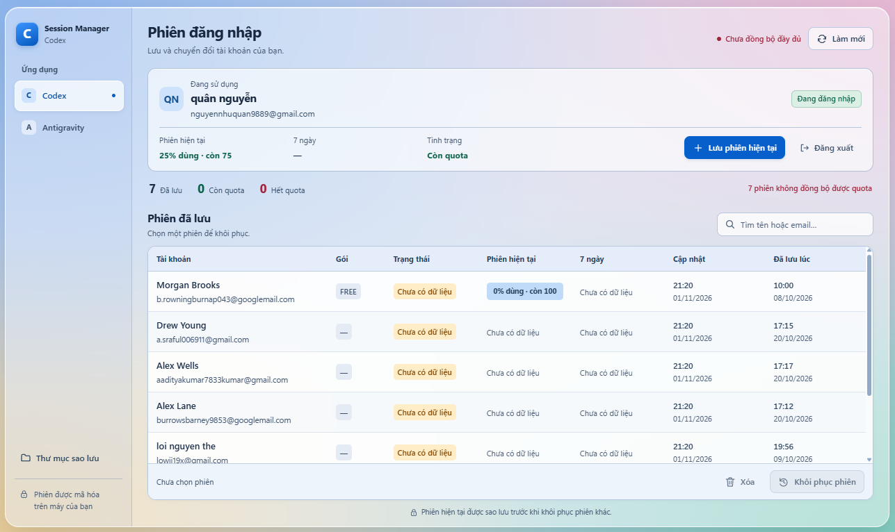
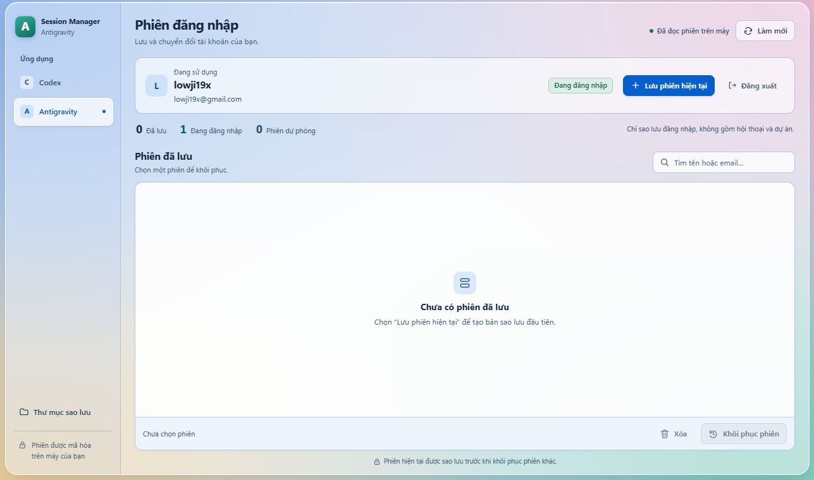
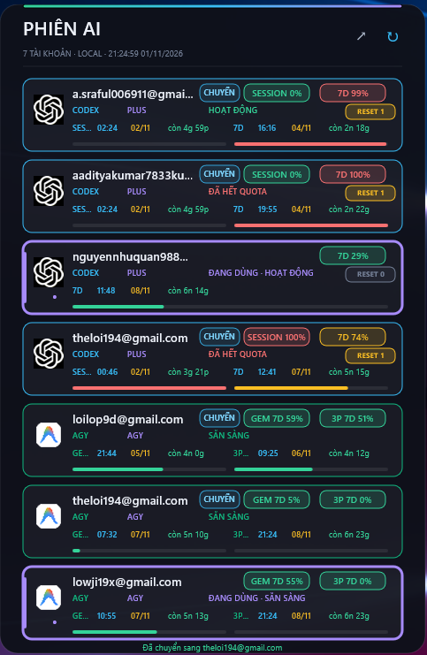

# Codex & Antigravity Session Manager

A Windows desktop application built with `pywebview` (Microsoft Edge WebView2) and a macOS Pastel UI to manage multiple Codex and Antigravity sessions under a single Windows user account. Includes an optional Rainmeter Quota AI skin (`rainmeter/QuotaAI`).

## Screenshots

### Codex

### Antigravity

### Rainmeter Quota AI

## Highlights

- Separate views for **Codex** (`SESSION` / `7-day` quota bars) and **Antigravity** (`GEM 5H / GEM 7D` and `3P 5H / 3P 7D`)
- Save, search, restore, and safely sign out sessions with Windows DPAPI-encrypted backups (`tool/backups`)
- Atomic file writes with rollback protection and automatic 5-minute quota refresh
- CLI support for Rainmeter skin switching (`main.py --switch-email EMAIL`) and headless health checks (`--self-check`)

## Running Portable Builds (Windows x64)

1. Download the archive from [Releases](https://github.com/lowji194/codex-session-manager/releases) (`offline` includes bundled Python + WebView2 Fixed Runtime; `lite` uses system Edge WebView2 Runtime).
2. Extract to a writable folder and launch `CodexSessionManager.exe` (keep `_internal` and `WebView2Runtime` next to the executable).

## Running from Source

Install Python 3.12 (x64) and Microsoft Edge WebView2 Runtime, then run `start-standalone.cmd`. See [scripts/PORTABLE_BUILD.md](scripts/PORTABLE_BUILD.md) for packaging details and [README.md](README.md) for the complete Vietnamese documentation.

## License

Released under the [MIT License](LICENSE).
